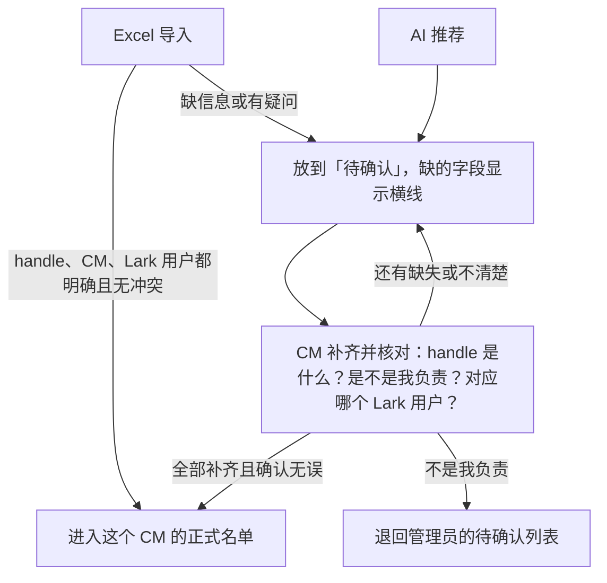

# 达人双来源归属与 Lark 用户确认：精简执行计划

日期：2026-09-09。状态：需求与制作计划，尚未实施。

## 通俗版：先看这里

**资料齐全、关系明确的才能正式入库；缺任何信息或拿不准的，都放“待确认”。** 不做整站改版。

拿 Remi 举例（handle 仅作说明）：

- Excel 明确写着 `@abc` 归 Remi，handle、负责人、对应 Lark 用户都已核对清楚且没有冲突：直接放进 Remi 的正式名单。
- AI 觉得 `@xyz` 归 Remi：先放到“待确认”，等 Remi 核对；推荐的人不对，可以换用户。
- 确定是 Remi 负责，但没有 handle、没有对应 Lark 用户，或不知道选哪个用户：**仍在“待确认”，不能先正式入库。** 缺的字段统一显示“—”；缺失原因留在详情或确认校验中，不用“缺 handle”等文字占据空字段。

页面只看四列：**达人 handle｜哪里来的｜对应的 Lark 用户｜现在什么状态**。拿不准时，再点开有权限看的聊天记录；不用先勾群，也不要求一定有私聊。

对应用户为空时，在这一格显示 **“—”和搜索框**：输入姓名，搜索当前 CM 自己有权查看的 Lark 联系人，从结果里选中一个，填回该行。不是只敲一个名字就算选好了，也不自动挑第一人。搜不到就继续“—”、继续待确认；选好了只是补资料，还要等其他信息齐全、确认无误后再点“确认并入库”。

制作顺序：**先做好 Excel 导入、补资料和确认按钮 → 再接 AI 推荐 → 用 Remi 的名单试一遍。** 以后完整确认且未变化的不用反复确认，只处理新增和有变化的。负责人不明或归属冲突的，留在管理员的待确认列表，不乱分配。

一页分享版：[PDF](../../output/pdf/creator-cm-flow-plain.pdf) · [可编辑 LaTeX 源文件](creator-cm-flow-plain.tex)。以下保留实施时参考的详细规则。

## 1. 本次方向

不做整站改版。沿用现有前端，把 Excel 导入和 OpenAI API 识别的账号汇总到对应 CM 的同一份列表，主列为：**达人 handle｜来源｜对应 Lark 用户｜状态**，右侧附操作。

已明确的原则：Excel 导入且资料齐全、关系确定的直接归 CM；AI 识别、Excel 模糊项及任何信息缺失项都进入待确认。**用户最新补充优先：handle、CM、对应 Lark 用户有任一缺失或不清楚，不得进入正式名单。** 不再采用“先正式归属、以后补用户”的方案。本计划替代旧原型“所有账号先逐行认领、勾选群聊”及缺资料也能正式确认的方向，但不改变已上线只读页的现状说明。

本轮只记录方案，不导入数据、不调用模型、不恢复旧 AI 开关、不调整正式归属或权限；消息风险分级和回复功能不在本计划内。

## 2. 两种来源，一条确认流程

必须分别记录 **handle 是什么、由哪个 CM 负责、对应哪个 Lark 用户**。这些信息可以逐步补全并保存草稿，但正式入库必须全部完整、清楚且无冲突。Excel 已写明的 CM 可以作为待确认线索保留，不提前写成正式负责关系。单聊不是必备资料；没有单聊不等于缺用户身份。

| 输入情况 | 进入哪个 CM 的列表 | 处理结果 |
|---|---|---|
| Excel 的账号与 CM 明确，且 Lark 映射也已可靠确认、无冲突 | 表中明确的 CM | 直接入库，显示“已确认入库”，注明 Excel 依据，不冒充本轮人工确认 |
| Excel 的账号与 CM 明确，但 Lark 用户缺失或未确定 | 表中明确的 CM | 留“待确认”，标明缺失/不确定原因，不写正式归属或用户关联 |
| 来源缺少 handle，但能定位候选 CM | 有依据的候选 CM | 状态为“待确认”，handle 格显示“—”；保留来源和缺失原因，不编造账号或丢弃该条 |
| Excel 的 handle/CM 对应关系模糊 | 有依据的候选 CM | 显示“待确认”，不自动建立有疑问的关系 |
| AI 发现账号、候选 CM 和候选 Lark 用户 | 有依据的候选 CM | 一律“待确认”；再高分也不直接归属或关联 |
| 未找到 CM、多个 CM 无法区分、与既有归属冲突 | 管理员的待确认列表 | 标明“负责人不明”或“归属冲突”，不猜负责人、不群发全体 CM、不覆盖已有关系 |

### Excel 怎样算“确定”

- 平台与 handle 可明确定位，不是仅凭相似拼写猜测另一个账号。
- CM 名称通过已维护的映射对应到唯一、有效内部账号；CM/TAP CM 多值或相互矛盾时不静默选其中一列。
- 对应 Lark 用户已经通过可信稳定 ID 或当前有效、已核验映射确认；不能缺失、只显示相似人选或仍有多个未决候选。
- 导入操作者有权提交该 CM 的名单，且不与当前正式负责人、既有身份风险或待交接状态冲突。
- 先显示导入预检：可直接入库、待确认及各项原因、无法解析的无效行；提交后按行返回结果。缺 handle 或缺用户的可解析来源行必须保留为待确认，不能按无效行静默丢弃。普通 CM 只能导入本人范围，跨 CM 导入沿用管理员权限。
- “直接关联 Lark 用户”还必须有可信的稳定 ID 或已核验、当前有效且无风险的既有映射。Excel 只有 handle 和 CM 时，不用姓名相同、同群、单聊存在或 AI 高分代替身份确认。

### CM 怎样确认

1. 打开“待确认”，查看来源、缺失项、候选用户及简短依据；必要时展开当前有权查看的会话证据。
2. 补齐并核对 handle、本人负责关系、对应 Lark 用户；缺用户时使用该行搜索框，在自己的可选 Lark 联系人范围内输入姓名并选中具体用户。推荐用户错误时可以更换，不必否认整个达人账号；选中或更换只保存为待确认资料。
3. 全部完整、清楚且无冲突后，才可点击“确认并入库”。任何一项仍缺失或拿不准，继续留待确认；可以保存补充进度，但不能创建正式归属或用户关联。
4. 不是本人负责：记录“不是我负责”，移出本人的待确认列表，交管理员核对，不自动转给下一名候选；暂时无法判断则保留“暂缓”。

保存草稿与正式确认必须区分。正式确认时，服务端再次校验必需资料、身份和权限，将账号归属、所选用户关联及审计一次性保存；全部成功才进入正式名单。资料未齐、存在未决疑问或提交失败时继续待确认，不允许部分转正。普通确认不再增加一轮审批，冲突项除外。

## 3. 页面最小调整

- **空字段统一显示：** 缺少值或尚未选定值的格子显示“—”，包括 handle、来源资料、对应用户等；状态仍正常显示“待确认”。横线只是展示符号，存储中保持空值，不把横线存成真实 handle 或用户。缺失/模糊原因保留在详情、筛选和确认校验中。
- **达人 handle：** 一行一个账号或待补来源记录；缺失时显示“—”，点击可补充，不用 Lark 显示名代替 handle。
- **来源：** Excel、AI 或 Excel + AI。详情保留文件/工作表/行号、CM 原值或 AI 证据；来源与确认状态分开。
- **对应用户：** 尚未选定时显示“—”及行内搜索框，提示“搜索我的 Lark 用户”；选择后显示头像、姓名及待确认标识，可更换/清除。同名时展示当前有权读取的稳定身份辨识信息，不能仅凭显示姓名关联；不造占位联系人。
- **用户搜索范围：** “我的用户”指当前 CM 在有效授权下可见、可选择的已同步 Lark 联系人，不是全公司人口库，也不只限于已经标为达人或已经正式归该 CM 的用户。搜索不能新增授权、启动同步或开放其他 CM 的联系人/聊天。只读评审账号不因能查看页面就获得搜索补填或代确认权限。
- **用户搜索行为：** 从搜索结果中明确选中真实联系人 ID 才算补上用户，不接受自由文本姓名冒充身份、不自动选择同名第一项。没有结果时提示“未找到可选用户”，该格仍显示“—”；搜索失败另报错误，保留原有选择/草稿，不当作没有用户。清除选择后恢复横线并保持待确认。
- **状态：** 主状态为“待确认”或“已确认入库”；缺 handle、缺 Lark 用户、用户不确定、负责人不明、归属冲突是详情里的待确认原因，可记录多个。暂缓仍属待确认；已否认保留历史并交管理员核对。选好用户不会自动转正，仍需资料齐全、无疑问并点击确认。
- **操作：** 补资料、更换用户、确认并入库、不是我负责、暂缓；未补齐时禁止正式确认，后端也必须拒绝绕过。批量确认仅提交资料完整且逐项明确选择的记录，未完整项继续待确认并逐项提示，不默认全选候选用户。
- 顶部保留“全部 / 待确认 / 已确认”以及缺失原因、来源筛选。待确认按候选记录计数，正式按去重账号计数；不把未知 handle 当作新达人账号计入正式总数。
- 不再把群聊、私聊勾选放在主流程中；详情复用现有按需查看证据。没有私聊不阻止确认，有私聊也不自动确认。

## 4. 最小必要规则

1. **去重：** 已知账号沿用平台 + 规范化 handle；同账号的 Excel/AI 来源合并展示，保留所有依据。缺 handle 时用独立候选记录 ID 与源文件/行号或消息引用保存、去重，不编造 handle，也不先创建正式账号。补齐后再次去重和检查冲突。相似 handle 只作候选，不自动合并或创建别名。
2. **账号不等于人：** 一名 Lark 用户可以对接多个 handle；一个账号的本人和代表须区分。关联代表不把代表自动标记成达人本人，也不合并不同自然人。
3. **不抢占：** 一个账号最多一位当前 CM；与其他 CM 的正式关系冲突时进入交接/管理员处理，不因导入或点击确认直接覆盖。
4. **只处理变化：** 重复导入、重复识别不重建账号或重置已确认结果；已否认的同一候选不因同一份证据反复推送，有实质新依据才重新待核对。文件少了一行不等于删除账号。
5. **关联不等于授权：** CM 仅处理本人范围；用户搜索在后端按当前 CM 的有效可见范围过滤，不先查全库再由前端隐藏。草稿补填和正式确认时再次验证所选联系人 ID 的真实存在与当前可选性，拒绝越权、伪造或已失效的 ID。证据读取独立检查权限；候选或已确认关联都不额外开放其他 CM 的聊天，也不修改同步设置。
6. **可纠错：** 保存前重验资料完整性、现有归属和版本；重试不重复入库，批量部分失败逐项显示。仅填入一个值不代表疑问已解决，缺失项和未决身份/归属疑问都须解除才能转正。撤销/交接保留历史，候选与正式关系不能混读。本次不撤销、重分配或清理既有正式数据，存量差异先做核对清单。

## 5. 制作执行计划（按顺序）

| 步骤 | 最小交付 | 验收重点 |
|---|---|---|
| 1. 补齐账号归属与候选记录 | 复用 `social_accounts`、`contact_social_accounts`、稳定 Lark 身份；补账号级 CM 归属、允许缺字段的候选记录、来源/确认记录 | 缺 handle/用户/明确负责人也能保存待确认来源；不依赖已存在的正式账号；存量风险映射不被迁移成已确认 |
| 2. 接通 Excel 与人工闭环 | 导入预检/提交；完整明确项直接入库，缺失/模糊项待确认；CM 范围内用户搜索/选中、补资料、确认、换用户、否认、暂缓接口 | 缺任何必需资料或仍不清楚时不能入库；搜索仅返回本人可选联系人；必须选中真实 ID；完整后原子转正；重复导入无重复账号；冲突不覆盖 |
| 3. 接通 AI 候选入口 | 复用现有 OpenAI 请求、任务和证据校验基础，输出 handle、候选 CM、候选用户、理由/证据、未知项；结果仅写候选 | 拒答、失败、无证据不伪装匹配成功；AI 不写正式角色/归属/身份关联，不因高分绕过确认 |
| 4. 接入现有前端并小范围验收 | 沿用现有列表/详情，改为四主列，空字段横线、缺用户行内搜索，接入当前 CM 范围与上述操作；建议先用 Remi 范围试运行 | 横线不落成业务值；无结果、搜索失败、同名用户、跨 CM 搜索/伪造 ID、选中后撤权、只输入姓名、选中仍待确认、清除选择、缺 handle 与批量缺失均覆盖；兼测一人多 handle、缺单聊、并发 |

当前真实核对页固定 Remi、只读；正式流程必须增加 CM 自己的作用域和写接口，不能仅换列名。Shuxuan Li/Shang Ma 若继续核对，沿用已有允许的只读身份，不因能看页面就取得代 CM 确认权。

目前 `contact_assignments` 是“联系人 → CM”，不能直接承担新的“账号 → CM”：认领某个 handle 不得把同一人的其他 handle 一并转走。存量先做映射预检、备份和冲突清单；新账号流程以账号级归属为准，旧联系人级读取逐一适配，不做跨账号隐式回写。无需重建人口库或引入新 UI 框架。

AI 输入限于有效授权的必要线索，聊天和表格内容只作证据，不执行其中指令。身份与负责人必须各有可追溯依据；私聊仅作辅助，不能凭“与某 CM 有私聊”确定达人身份或归属。候选 CM/用户必须来自服务端允许的 ID 集合，证据使用真实 `(chat_id, message_id)` 引用。缺 handle 仍进入统一待确认列表并标明原因，不编造账号，不因缺字段丢弃来源。

OpenAI 结构化输出可约束返回格式，但仍可能判断错误。因此这里把它用于候选生成，业务校验和 CM 确认仍独立保留；模型/分数阈值在样本核对后决定，不承诺置信度即准确率。[OpenAI 官方结构化输出说明](https://developers.openai.com/api/docs/guides/structured-outputs)

**交付边界：** 本期计划只做“来源汇总 → 归属/身份确认 → 正式名单”，不做会话勾选系统、自动回复、全库自动重新认人或无边界历史扫描。首次确认后仅处理新增、冲突、交接和关联变化。
